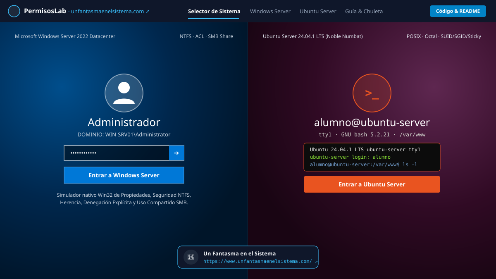
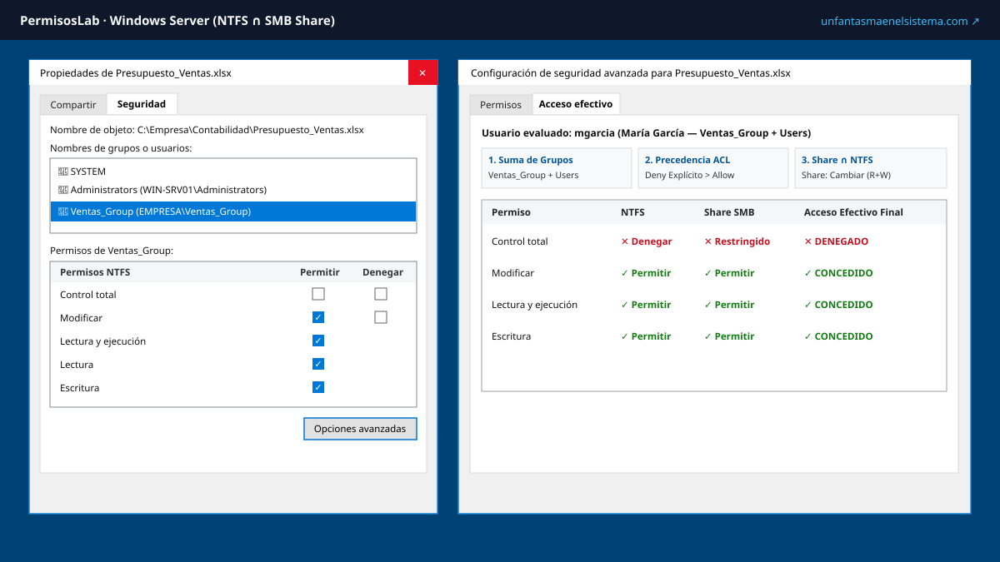
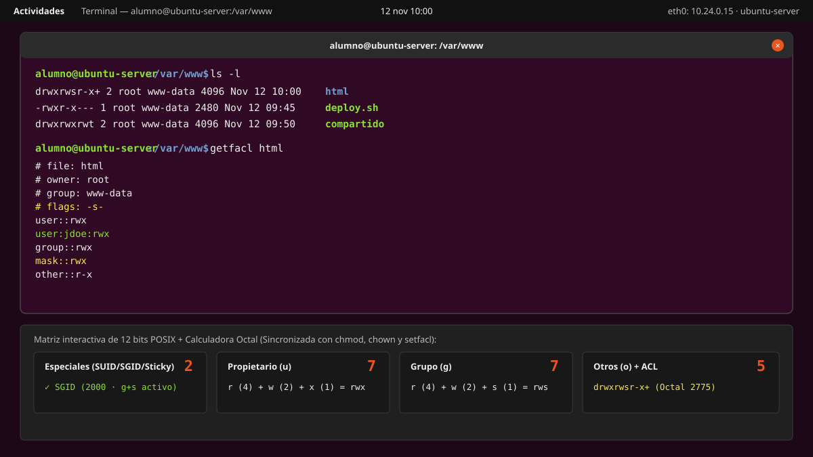
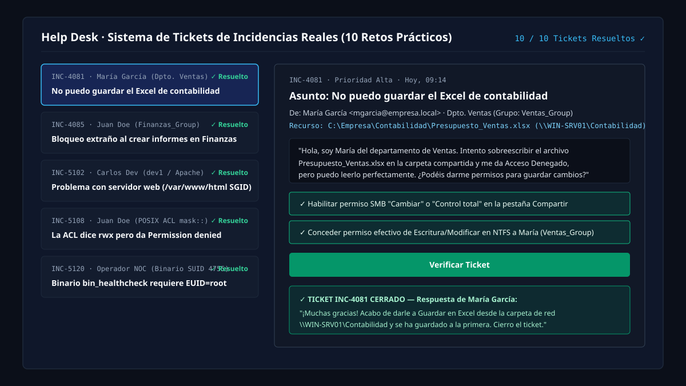

<div align="center">

<a href="https://www.unfantasmaenelsistema.com/" target="_blank" rel="noopener noreferrer">
  
</a>

# PermisosLab — Simulador Nativo de Permisos Windows Server & Ubuntu Server

**Laboratorio interactivo "Pixel-Perfect" para el aprendizaje práctico de permisos NTFS, Recursos Compartidos SMB, permisos UGO tradicionales, bits especiales (SUID/SGID/Sticky) y listas de control de acceso POSIX ACL (`getfacl` / `setfacl`).**

Desarrollado para **[Un Fantasma en el Sistema](https://www.unfantasmaenelsistema.com/)** · 100% Estático · Preparado para **GitHub Pages**

[](https://www.unfantasmaenelsistema.com/)
[](#1-entorno-windows-server-ntfs--smb-share)
[](#2-entorno-ubuntu-server-bash--ugo--posix-acl)
[](#3-modo-retos-sistema-de-tickets-help-desk)

</div>

---

## Tabla de Contenidos

1. [Descripción del Proyecto](#descripción-del-proyecto)
2. [Capturas del Laboratorio](#capturas-del-laboratorio)
3. [Instrucciones de Instalación y Despliegue](#instrucciones-de-instalación-y-despliegue)
4. [Guía de Uso del Laboratorio (Windows y Linux)](#guía-de-uso-del-laboratorio-windows-y-linux)
   - [1. Entorno Windows Server (NTFS y SMB Share)](#1-entorno-windows-server-ntfs-y-smb-share)
   - [2. Entorno Ubuntu Server (Bash, UGO y POSIX ACL)](#2-entorno-ubuntu-server-bash-ugo-y-posix-acl)
   - [3. Modo Retos: Sistema de Tickets Help Desk](#3-modo-retos-sistema-de-tickets-help-desk)
5. [Tecnologías Utilizadas](#tecnologías-utilizadas)
6. [Enlaces y Créditos — Un Fantasma en el Sistema](#enlaces-y-créditos--un-fantasma-en-el-sistema)

---

## Descripción del Proyecto

**PermisosLab** es un simulador educativo de administración de sistemas y ciberseguridad diseñado con fidelidad visual **Pixel-Perfect** para que estudiantes y profesionales de TI practiquen la resolución de incidencias reales de control de acceso sin necesidad de levantar máquinas virtuales pesadas.

El proyecto aborda los dos estándares de permisos más utilizados en infraestructuras empresariales:

- **Microsoft Windows Server (NTFS + SMB Share)**: Réplica exacta de los cuadros de diálogo nativos Win32 de Windows 10/11 y Windows Server 2022 (*Propiedades de carpeta*, pestañas *Compartir* y *Seguridad*, modal de *Configuración de seguridad avanzada*, gestión de *Herencia* y cálculo de *Acceso efectivo*).
- **GNU/Linux Ubuntu Server 24.04 LTS (UGO + SUID/SGID/Sticky + POSIX ACL)**: Réplica de una consola **GNOME Terminal** interactiva (`alumno@ubuntu-server:/var/www$`) combinada con una matriz visual de 12 bits POSIX sincronizada en tiempo real.
- **Aprendizaje Basado en Problemas Reales (Help Desk)**: Incluye una bandeja de entrada con **10 tickets de soporte técnico** (5 de Windows y 5 de Linux) enviados por usuarios de distintos departamentos (*Ventas*, *Finanzas*, *RRHH*, *DevOps*, *Desarrollo Web*, *Auditoría PCI-DSS* y *NOC*).

---

## Capturas del Laboratorio

### Selector de Entorno Inicial (Pantalla de Login Doble)


### Réplica Nativa Windows Server (Propiedades + Configuración de Seguridad Avanzada)


### Réplica Terminal Ubuntu Server 24.04 LTS (Bash + `getfacl` + Matriz de 12 Bits POSIX)


### Sistema de Tickets Help Desk (10 Casos Prácticos Verificables)


---

## Instrucciones de Instalación y Despliegue

El proyecto está construido con arquitectura **100% estática y modular** (HTML5 + CSS3 + ES6 Modules), por lo que puede ejecutarse directamente en local o alojarse gratuitamente en **GitHub Pages**.

### 1. Clonar el repositorio

```bash
git clone https://github.com/<tu-usuario>/permisoslab.git
cd permisoslab
```

### 2. Ejecutar en entorno local

Dado que el navegador carga módulos JavaScript nativos (`<script type="module" src="./js/main.js">`), debes servir los archivos mediante cualquier servidor HTTP local:

#### Opción A: Con Node.js / Vite (Recomendado para desarrollo)
```bash
npm install
npm run dev
```
*(La aplicación estará disponible en `http://localhost:3000`)*.

#### Opción B: Con Python 3 (Sin instalar dependencias)
```bash
python3 -m http.server 8080
```
*(Abre `http://localhost:8080` en tu navegador)*.

#### Opción C: Con la extensión Live Server de VS Code
Haz clic derecho sobre `index.html` y selecciona **"Open with Live Server"**.

### 3. Desplegar en GitHub Pages

1. Sube el código a tu repositorio de GitHub (`git push origin main`).
2. En GitHub, dirígete a **Settings** $\rightarrow$ **Pages**.
3. En **Build and deployment** $\rightarrow$ **Source**, selecciona **Deploy from a branch**.
4. Elige la rama `main` y la carpeta `/ (root)` y pulsa **Save**.
5. En menos de un minuto tu simulador estará publicado en `https://<tu-usuario>.github.io/permisoslab/`.

---

## Guía de Uso del Laboratorio (Windows y Linux)

Al iniciar **PermisosLab**, verás la pantalla de login doble que te permite entrar a **Windows Server** o a **Ubuntu Server**, además de la barra superior desde la que puedes cambiar de sistema en cualquier momento o abrir el modal **Guía & Chuleta**.

---

### 1. Entorno Windows Server (NTFS y SMB Share)

En el escritorio de Windows Server dispones de tres componentes interactivos:

1. **Explorador de Archivos y Simulador de Acceso en Vivo**:
   - Selecciona cualquiera de los 5 recursos del servidor (`Presupuesto_Ventas.xlsx`, `Finanzas`, `Nominas_2026.xlsx`, `Deploy-Prod.ps1` o `Proyectos_2026`).
   - En el recuadro inferior **Simulador de Acceso en Red**, elige un usuario del dominio (`mgarcia`, `jdoe`, `carlos_sre`, `admins`, `guest`) y pulsa **Probar Leer** o **Probar Guardar** para comprobar si el sistema devuelve `[Win32 OK]` o `[Error 0x80070005: Acceso denegado]`.
2. **Ventana `"Propiedades de [Recurso]"`**:
   - **Pestaña Compartir**: Activa o desactiva el recurso compartido SMB (`\\WIN-SRV01\...`) y define los permisos de red (*Leer*, *Cambiar*, *Control total*).
   - **Pestaña Seguridad**: Agrega o quita usuarios/grupos en la ACL NTFS y marca las casillas **Permitir** o **Denegar** (*Control total*, *Modificar*, *Lectura y ejecución*, *Lectura*, *Escritura*).
   - En la parte inferior verás actualizado en tiempo real el comando **`icacls`** equivalente de PowerShell/CMD.
3. **Ventana `"Configuración de seguridad avanzada"` (Botón *Opciones avanzadas*)**:
   - **Pestaña Permisos**: Permite **Deshabilitar herencia** (*Convertir los permisos heredados en permisos explícitos* o *Quitar todos los permisos heredados*) o volver a habilitarla.
   - **Pestaña Acceso efectivo**: Calcula paso a paso el permiso final aplicando las 3 reglas de oro de Windows:
     $$\text{Permiso Efectivo} = \left(\bigcup \text{Grupos del Usuario} \setminus \text{Denegaciones Explícitas}\right)_{\text{NTFS}} \cap \text{Permiso Share}_{\text{SMB}}$$

---

### 2. Entorno Ubuntu Server (Bash, UGO y POSIX ACL)

En el escritorio de Ubuntu Server dispones de una consola **GNOME Terminal** interactiva situada en `/var/www` y un panel inferior con la **Matriz de 12 bits POSIX**:

#### Comandos soportados en la terminal Bash
| Comando | Ejemplos de uso en el simulador | Descripción |
| :--- | :--- | :--- |
| `ls` | `ls -l`, `ls -la /var/www/html`, `ls -ld html` | Lista permisos UGO, bits SUID/SGID/Sticky y el sufijo `+` cuando existen ACLs extendidas. |
| `getfacl` | `getfacl html`, `getfacl config.php` | Muestra propietario, `# flags:` (`s`/`t`), entradas `user:`, `group:`, `mask::` y el cálculo `#effective:`. |
| `setfacl` | `sudo setfacl -m u:jdoe:rwx html`<br>`sudo setfacl -m m::rwx html`<br>`sudo setfacl -x u:jdoe html`<br>`sudo setfacl -b html` | Añade/modifica entradas ACL (`-m`), actualiza la máscara (`m::`), elimina una entrada (`-x`) o borra toda la ACL (`-b`). |
| `chmod` | `sudo chmod 2775 html`<br>`sudo chmod 1777 compartido`<br>`sudo chmod 4755 bin_healthcheck`<br>`sudo chmod u+s,g+s,o-rwx archivo` | Cambia permisos en modo octal (3 o 4 dígitos) o simbólico (`u`, `g`, `o`, `a`, `+`, `-`, `=`, `r`, `w`, `x`, `X`, `s`, `t`), con soporte recursivo `-R`. |
| `chown` / `chgrp` | `sudo chown -R :www-data /var/www/html`<br>`sudo chown root:www-data deploy.sh` | Modifica el propietario y/o grupo del inodo (soporta `-R`). |
| `su` | `su - jdoe`, `su - www-data`, `su - auditor`, `su - alumno` | Cambia de usuario activo en la sesión de terminal para poner a prueba los permisos reales. |
| `touch` / `mkdir` | `touch /var/www/html/release.txt`<br>`mkdir /var/www/html/uploads` | Crea archivos o carpetas evaluando permisos reales de escritura/ejecución y heredando el grupo si el directorio padre tiene activo el bit **SGID (`2000`)**. |
| `rm` / `cat` | `rm /var/www/compartido/fichero`<br>`cat /var/www/config.php` | Prueba la lectura de archivos o el borrado verificando la protección del **Sticky Bit (`1000`)**. |
| `./binario` | `./bin_healthcheck` | Ejecuta un archivo comprobando permisos `x` y mostrando `[EUID=... EGID=...]` según los bits **SUID/SGID**. |
| `id` / `whoami` / `umask` | `id`, `groups`, `whoami`, `umask 027` | Consulta la identidad del usuario actual, sus grupos o la máscara de creación `umask`. |

---

### 3. Modo Retos: Sistema de Tickets Help Desk

En el panel lateral derecho se encuentra el cliente **Help Desk** con **10 tickets reales** (5 para Windows Server y 5 para Ubuntu Server):

| Código | Sistema | Usuario Remitente | Resumen del Problema | Solución Técnica Esperada |
| :--- | :--- | :--- | :--- | :--- |
| **INC-4081** | Windows | María García (`Ventas_Group`) | Puede leer `Presupuesto_Ventas.xlsx` por red, pero le da *Acceso Denegado* al guardar. | Subir Share SMB a **Cambiar** y conceder **Modificar** a `Ventas_Group` en NTFS. |
| **INC-4085** | Windows | Juan Doe (`Finanzas_Group`) | Tiene permiso *Modificar* en `Finanzas_Group`, pero no puede escribir en `C:\Empresa\Finanzas`. | Eliminar la casilla **Denegar Escritura** asignada al grupo `Users`. |
| **INC-4090** | Windows | Dirección RRHH (`RRHH_Group`) | Cualquier empleado del dominio puede abrir y leer `Nominas_2026.xlsx`. | **Deshabilitar herencia NTFS**, quitar a `Users` y dar **Modificar** a `RRHH_Group`. |
| **INC-4094** | Windows | Carlos SRE (`DevOps_Group`) | Blindar `Deploy-Prod.ps1` para que DevOps pueda ejecutarlo pero nunca modificarlo. | Dejar a `DevOps_Group` solo con **Lectura y ejecución** (desmarcando *Modificar* y *Escritura*). |
| **INC-4099** | Windows | PMO Corporativa | Compartir `Proyectos_2026` en red para los departamentos de Ventas y Finanzas. | Activar **Compartir SMB (Cambiar)** y dar **Modificar** en NTFS a `Ventas_Group` y `Finanzas_Group`. |
| **INC-5102** | Linux | Carlos Dev (`dev1`) | Apache (`www-data`) no puede leer `/var/www/html/index.php` ni heredar grupo. | `sudo chown -R :www-data /var/www/html && sudo chmod 2775 /var/www/html && sudo chmod 640 /var/www/html/index.php` |
| **INC-5108** | Linux | Juan Doe (`jdoe`) | Tiene `user:jdoe:rwx` en la ACL de `/var/www/html`, pero `touch` devuelve *Permission denied*. | Desbloquear la máscara ACL: `sudo setfacl -m m::rwx /var/www/html` |
| **INC-5115** | Linux | Auditoría Interna | Usuarios borran archivos de otros en `/var/www/compartido` y `deploy.sh` tiene modo `0666`. | `sudo chmod 1777 /var/www/compartido && sudo chown root:www-data /var/www/deploy.sh && sudo chmod 750 /var/www/deploy.sh` |
| **INC-5120** | Linux | Operador NOC (`alumno`) | El binario `/var/www/bin_healthcheck` debe correr con `EUID=root` sin usar `sudo`. | `sudo chown root:root /var/www/bin_healthcheck && sudo chmod 4755 /var/www/bin_healthcheck` |
| **INC-5125** | Linux | Elena Auditora (`auditor`) | Ocultar `/var/www/config.php` a `other` y dar lectura puntual a `auditor` con ACL. | `sudo chown root:www-data /var/www/config.php && sudo chmod 640 /var/www/config.php && sudo setfacl -m u:auditor:r-- /var/www/config.php` |

---

## Tecnologías Utilizadas

- **HTML5 Semántico**: Estructura accesible con diálogos nativos, pestañas `tablist` y consola interactiva.
- **CSS3 Modular Nativo (Sin dependencias externas)**:
  - `css/windows.css`: Réplica visual de controles Win32 (Windows 10/11 / Server 2022), bordes de `1px`, estados `:hover` / `:focus`, tablas ACE y casillas de verificación nativas.
  - `css/linux.css`: Estética **Ubuntu Yaru Dark** y **GNOME Terminal** (`#300a24` Aubergine / `#0c0c0c`), tipografía `Ubuntu Mono` y paleta oficial de colores GNU `LS_COLORS`.
  - `css/main.css`: Diseño adaptable de pantalla dividida (Dual-OS Login Selector), cliente Help Desk y Guía Teórica.
- **JavaScript ES6+ (Vanilla JS / ES Modules)**:
  - `js/windowsEngine.js`: Motor determinista de evaluación NTFS, herencia, precedencia de ACEs, recursos compartidos SMB y generación de comandos `icacls`.
  - `js/linuxEngine.js`: Emulador de sistema de archivos en memoria (inodos) e intérprete de comandos Bash con evaluación bit a bit de UGO, SUID/SGID/Sticky y POSIX.1e ACLs (`mask::` y `#effective`).
  - `js/challenges.js`: Definición declarativa JSON de los 10 tickets de soporte y funciones de validación técnica en vivo.
- **Vite**: Servidor de desarrollo rápido y empaquetador opcional.

---

## Enlaces y Créditos — Un Fantasma en el Sistema

<div align="center">

<a href="https://www.unfantasmaenelsistema.com/" target="_blank" rel="noopener noreferrer">
  
</a>

### [Un Fantasma en el Sistema](https://www.unfantasmaenelsistema.com/)
**Blog y plataforma de recursos sobre Administración de Sistemas, Ciberseguridad, Redes, Windows Server y GNU/Linux.**

🔗 **Web Oficial:** [https://www.unfantasmaenelsistema.com/](https://www.unfantasmaenelsistema.com/)

</div>
